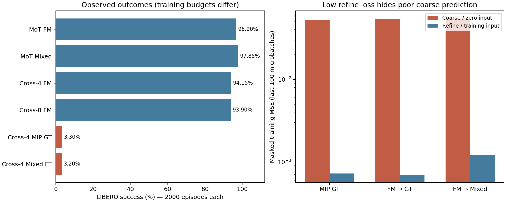

# FastestWAM：实验审计与 arXiv 成稿差距

审计日期：2026-10-18。基于本地原始实验记录；新增四小时实验另行汇总。

## 当前判断

已经具备写一篇**复现与负结果研究初稿**的素材，尚不具备宣称“更快且更强的新 WAM 方法”的证据。最有价值的问题是：在 OpenWAM 中，浅层动作模块与两步回归式 refinement 为什么出现显著兼容性差异？目前是现象，不能写成已证实的机制。

本项目是 OpenWAM 的研究分支，新增 MIP action objective、GT/Mixed/Pred refinement、浅层 cross-attention 动作头、实验编排及计算日志。视频目标仍是 FM，但 **MIP 的推理路径固定视频噪声状态，而 FM 路径会迭代视频状态**；目标对比并非只改变 action loss。这是必须审计的混杂因素。

仓库中的 `DoT` 是 `joint_cross_attn` + 4/8 个 video bridge 的本地命名。它不是 Faster-WAM 的完整 Dock of Transformers/Lite KV-Fusion 复现，论文必须明确区分。`SF` 在本仓库指 prediction-conditioned mixed refinement；不能把它直接称为完整复现视频 Self Forcing 的训练算法。

## 已核对的结果

`results/research_audit_20261018/` 保存 22 组评测、28,302 条 episode 记录，其中 14 组为完整 40×50 评测。逐任务 successes/trials 已与原始 results.json 对照一致；小规模诊断不得混入正式均值。详见 `runs.csv`、每组 `audit.json`、`episodes.csv`、评测 manifest、训练 config 及压缩训练日志。原始摘要和 manifest 的 SHA256 保留在 audit 中，归档路径已转换为仓库相对路径。

| 模型 / 目标 | 成功数 / 2000 | 成功率 | 可以支持的结论 |
|---|---:|---:|---|
| 官方 Alpha sim-libero，FM 2-step | 1991 | 99.55% | 发布权重在本地协议上的参考值，非同预算对照 |
| MoT FM 2-step，自训练 | 1938 | 96.90% | 5 epoch 深层基线 |
| MoT MIP Mixed | 1957 | 97.85% | 单次运行比 FM 高 0.95pp，需重复验证 |
| MoT MIP GT（早期实验） | 1916 | 95.80% | 单独训练方案，不能与 Mixed 直接作公平消融 |
| MoT MIP-4（早期实验） | 1905 | 95.25% | 增加迭代未在该次运行改善成绩 |
| DoT-4 FM | 1883 | 94.15% | 4 epoch 浅层基线 |
| DoT-8 FM | 1878 | 93.90% | 一次运行中未表现出整体深度收益 |
| DoT-4 FM 续训 +2 epoch，冻结视频 | 1884 | 94.20% | 冻结策略在 FM 路径下仍有效 |
| DoT-4 MIP Mixed，foundation 初始化 | 91 | 4.55% | 本配方严重失败 |
| DoT-4 FM→MIP Mixed，冻结视频 | 64 | 3.20% | 本次切换失败 |
| DoT-4 FM→MIP GT | 58 | 2.90% | 改为 GT refinement 未修复 |
| DoT-4 MIP GT，foundation 初始化 | 66 | 3.30% | 不需要 FM 动作头切换或 Mixed 也会失败 |

最新 DoT-8 分项：Spatial 98.0、Object 94.6、Goal 92.2、Long 90.8。DoT-4 FM 对应 97.6、96.2、93.6、89.2。因此总体小幅下降掩盖了 Long +1.6pp / Goal −1.4pp 的变化，不宜只展示总体数。

## 新发现：零输入下的时间对称性（已复现，恢复成功率待验证）

本地 cross-attention ActionDiT 的动作编码是逐 token 线性层，没有绝对位置编码。MIP 初始输入是全零，因此所有 action token 相同。self-attention 的 RoPE 只改变 Q/K，而 V 仍完全相同：每行 attention 权重的加权和仍是同一个 V。bridge/text cross-attention 没有位置编码，相同 query 读取相同输出；逐 token FFN 和全局 timestep 调制也保持相同。由层数归纳，任何深度都不能产生时间上不同的动作。确定性 `0.9*pred0` refinement 继续保留这一性质。浮点计算会产生微小误差，这不是可依赖的时间信号。

实际训练的 DoT-4 MIP-GT action weights + 合成 bridge 条件下，fp32 coarse/refine 最大时间差分别为 2.61e-7 / 2.83e-7；scale0.1 时分别为 0.140 / 0.215（未训练位置编码，不能解释为成功率恢复）。可复现脚本为 `diagnose_mip_temporal_symmetry.py`，结果见 `trained_mip_symmetry.json`。

`tests/test_mip_temporal_symmetry.py` 在 1/4/8 层、带随机 video bridge 和文本条件下复现该性质，fp32 的最大 token 差约 1e-7；Gaussian action 输入能够打破它。MoT 把 action query 与位置编码后的多样 video value 联合注意力，因此不受这个相同的归纳约束。这为 FM 正常而 MIP 失败提供了具体的结构解释，**但还没有证明它是全部闭环失败的唯一原因**。

数据侧也有独立证据：从 273,465 个训练 windows 中固定 seed42 抽取 1,024 个，对每个 32-step chunk 求“知道未来真值的最优时间常量动作”，按真实有效维度/时间 mask 计算 MSE，平均下界为 **0.05487**。历史 DoT-MIP coarse 的末 100 microbatches 均值约 **0.053–0.055**，数量级吻合这个表达能力下界。它们来自不同样本，不能逐点作下界比较；但这比“训练没收敛”的解释更具体。真实 checkpoint 的 CPU bf16 诊断中，未修复 coarse/refine 的时间差甚至都为 **0**。详见 `constant_action_lower_bound.json`、`trained_mip_symmetry_bf16.json`。

新增 `model.architecture.action_position_scale`：默认 0 保持所有旧 checkpoint 行为；正值在 cross-attention 的动作 embedding 上加入固定 sinusoidal position，不增加 checkpoint 参数。不能直接声称改推理即可恢复性能；需要训练适配。`run_mip_position_rescue.sh` 做同一个已训 MIP-GT checkpoint 的两臂短程 continuation：scale=0 / 0.1，冻结视频、同 seed、同 batch 和 1500 microbatches，再各做 40×5 的诊断评测。这是时间受限的机制实验，不替代完整收敛和多 seed 控制。

## 不确定性与图表

按 40 个 task 配对 bootstrap（20,000 次，seed42）：MoT Mixed−FM 为 +0.95pp，95% 区间约 [-0.50, 2.55]pp；DoT-8−DoT-4 FM 为 −0.25pp，区间约 [-1.65, 1.05]pp。两者都包含零。这不是训练种子置信区间。算法和完整统计见 `analyze_research_evidence.py` 与 `statistics.json`。

## 必须纠正的解释

1. **“FM velocity→MIP x0 是崩溃根因”尚未成立。** 新训练的 MIP-GT 同样失败。参数语义切换可能解释某一条路径，无法解释全部结果。
2. **“浅层容量不足，所以加到 8 层就会恢复”没有被支持。** 目前只有一个训练种子，且没有 8 层 MIP 对照。
3. **“Mixed 修复 precision/long task”没有被支持。** MoT Mixed 的 Long 为 93.8%，FM 为 94.0%。独立 task06 评测还存在 FM 88%/96% 两次差异，需要追查 RNG、运行配置及重复性。
4. **“同算力公平”没有被测量。** 主实验 `measure_flops=false`，记录值是 0，不是实际零计算。MoT 5 epoch、DoT 4 epoch，也不能直接用来声称同预算架构优越。
5. **“同样 2 NFE”不等于同样计算。** 本地 MIP 每个分支都重新执行完整 joint forward；cross-attention 不会自动复用视频 bridge。还需分别数 action/video forward 和测量端到端延迟。
6. **“fair continuation pair”需精确限定。** FM 用 8 ranks×8×accum2，MIP 用 4 ranks×8×accum4；两者各见 546,944 examples、记录 4,274 optimizer updates、有效 batch128。它们是样本数/更新数对齐，不是实测 FLOPs 或完全相同并行配置对齐。
7. **训练 loss 不能当作闭环成功率。** DoT MIP 的 coarse branch 明显比 refine branch 差；GT 附近 refinement loss 很低可能只是容易的去噪任务。必须看部署时 pred0→pred1 的 held-out 误差，而非只看 teacher-conditioned train loss。

## 已启动的最后四小时实验

启动脚本：`scripts/experiments/run_last4h_evidence.sh`。默认上限 13,200 秒并留出退出时间；每组 40 tasks×10 trials，单独目录，标记 `-diagnostic` 协议。读取 `outputs/last4h_latest.txt` 定位当前运行。初次启动被 canonical 50-trial 守卫拒绝，随后加入显式 diagnostic 开关；未更改默认正式协议，相关回归测试通过。

| policy GPU / EGL GPU | 实验 | 目的 |
|---|---|---|
| 0 / 4 | DoT-4 FM，1 step，seed42 | 最便宜的一步控制是否可行 |
| 1 / 5 | DoT-8 FM，1 step，seed42 | 一步条件下的深度效应 |
| 2 / 6 | MoT FM，1 step，seed42 | 比较深浅架构对单步积分的敏感性 |
| 3 / 7 | DoT-4 FM，2 step，seed43 | 评测种子敏感性；不等于新训练种子 |

对照从历史 50-trial 记录取每任务前 10 个 trial，避免用 400 episodes 直接比较历史 2000 episodes。seed42 一致不保证推理随机噪声完全相同，应报告为匹配任务与初始状态的比较。若截止时不完整，仅报告完成子集并列出覆盖范围。

同时启动 `probe_last4h_flops.sh`：在 4–7 卡剩余显存上做 DoT-4/MoT × FM/MIP 四个 6-microbatch 校准，不保存权重。该测量是 batch1、4 ranks 下的算子计数，不能伪装成历史 batch8 的实测总预算。与 EGL 共用 GPU 的 wall time 也不能作为独占吞吐基准。校准值是否可用，以实际日志及缺失算子检查为准。

## 论文最小补齐清单

| 优先级 | 缺口 | 最小可接受证据 | 预估后续资源（不是已测 ETA） |
|---|---|---|---|
| P0 | 排除实现/推理错误 | 固定同一 observation、video noise、action mask；GT-input 与 pred-input 分支误差；核对模型实际 objective、归一化及梯度流 | 0.5–1 天工程 + 数小时 GPU |
| P0 | 机制证据 | 同一初始化下 video conditioning/noise sweep 或 bridge 控制；至少一个能修复失败的可控干预 | 1–3 天迭代，结果可能为否 |
| P0 | 稳定性 | 核心四臂至少 3 个训练种子，报告 mean/std 和 task-cluster bootstrap；评测 seed 不能替代训练 seed | 约 2–4 天 8×H100，取决于并行评测 |
| P0 | 速度与预算 | 同硬件/精度/编译/cache/分辨率/chunk；warmup 后 p50/p95、显存、action/video NFE，分别给 forward 和端到端 | 数小时 |
| P1 | 泛化 | LIBERO-Plus 或第二个 benchmark；若准备高质量会议投稿，优先真实机器人 | 已装好环境时 0.5–2 天；新环境更久 |
| P1 | 文稿与复现 | 完整配置、训练/评测源码版本、checkpoint 获取方式、失败案例、统计方法和 limitations | 1–2 天整理 |

不必把上表全部做完才“技术上能上传 arXiv”；这是对可信研究质量的判断，不是 arXiv 的接收规则。若只写诚实的单 benchmark 复现/负结果技术报告，排除实现错误、补延迟和重复性、写清局限后即可形成初稿。若要写新的 SOTA 方法论文，还缺方法贡献和成功的关键对照，不能承诺四小时内达到。

建议标题方向：**When Two-Step Action Regression Fails in Shallow World–Action Models: An OpenWAM Case Study**。避免使用“Fastest”作为已证明的速度结论。文章结构：问题与文献边界 → 架构/目标与计算图 → 协议和初始化 → 完整成功/失败结果 → 因果控制（未完成前标为假设）→ 成本与局限。

## 已核实的相关工作与区别

以下链接于 2026-10-18 查询原论文/正式论文集；相关性判断是本次研究建议，不代表已完成独立复现。

- [OpenWAM](https://arxiv.org/abs/2609.07398)：基础框架与预训练来源，必须明确继承范围。
- [Faster-WAM](https://arxiv.org/abs/2608.02365)，2026-10-06 v2：已经研究浅层动作专家、DoT 与 Lite KV-Fusion。浅层结构本身不能作为我们的新贡献；本地 bridge 实现也不能冒充该方法复现。
- [Much Ado About Noising / MIP](https://arxiv.org/abs/2512.01809)：两步回归式控制的直接来源。当前工作更适合检验 MIP 在预训练 WAM 和跨模块特征条件下的适用边界。
- [Self Forcing](https://arxiv.org/abs/2506.08009)：处理自回归视频模型的训练/推理分布差异；本地 GT/pred 混合只借鉴自生成输入思路。
- [Consistency Policy](https://arxiv.org/abs/2405.07503)、[OneDP](https://proceedings.mlr.press/v267/wang25ba.html)：明确的 teacher/student 少步蒸馏对照；若转向加速方法，需要与它们的思想及成本比较。
- [MP1](https://arxiv.org/abs/2507.10543)：学习区间平均速度，不是直接把已有 FM 的一步 Euler 当 MeanFlow；实现需要匹配训练目标和时间条件。
- [One-Step Flow Policy](https://arxiv.org/abs/2603.12480)：自蒸馏/一致性及 warm-start 的近期对照，单纯提出“一步 flow policy”已不新颖。
- [JEPA Policy](https://arxiv.org/abs/2609.09630)：共享 Transformer 中两次动作/未来表示 refinement，与“未来表征如何帮助两步动作回归”直接相关。
- [DUST](https://arxiv.org/abs/2510.27607)：模态分离噪声与异步采样，适合讨论 video/action 时钟这一混杂因素。

## 保存范围与复现限制

GitHub 保存研究代码、测试、配置、逐 episode 结果、压缩标量日志与审计。大模型权重、原始训练数据、环境目录和 `.env` 不进入 Git。权重现存于本机 `outputs/experiments/`；这份 Git 备份不等于权重备份。历史运行未全面记录源码 commit，无法追溯证明当时执行代码与当前 HEAD 完全一致；评测 manifest 和配置哈希只能覆盖其实际记录的部分。

## 本轮新增机制实验与自动归档

三个训练种子的合成条件轨迹回归（每臂 500 updates、128 train / 64 test observations）中，不加位置编码的测试 MSE 为 0.1446 / 0.1511 / 0.1513，接近各自常量轨迹 oracle 下界；scale0.1 降到 0.00353 / 0.00433 / 0.00400。这只是小模型表达能力实验，不是 LIBERO 成绩，也不代表真实模型的修复已成功。数据与脚本分别为 `toy_position_regression.json` / `toy_mip_position_regression.py`。

`collect_last4h_evidence.py` 每分钟保存完成任务、未完成覆盖范围、FLOPs 和修复训练曲线到 `results/last4h_20261018/`，不把未完成任务计作失败。观察器截至北京时间 23:40。GPU6 的原 MoT 渲染分支因连续 SIGABRT 被终止并标记排除；独立重跑改为 policy/render 均在 GPU2，结果名带 `render2`，不与旧进程结果混合。

GPU0 评测结束后，`queue_last4h_latency.sh` 排队执行独占延迟测量：同卡、eager、关闭 DiT cache、warm prompt cache，horizon1 强制每次重新生成 chunk，固定合成图像，记录 warmup 后 p50/p95。该测量包含 server.predict 前处理及生成，不包含 WebSocket 或 simulator；若因时限未执行，不填造延迟结果。

## 本轮实测 FLOPs（6-microbatch 校准已完成）

| 架构 | FM TFLOPs / rank / microbatch | MIP-GT TFLOPs / rank / microbatch | 比值 |
|---|---:|---:|---:|
| Cross-4 | 24.6699 | 40.4911 | 1.6413× |
| MoT | 25.4773 | 42.1059 | 1.6527× |

每 rank batch1、4 ranks、bf16、ZeRO2、gradient checkpointing；计数器包住 loss + backward，首步 warmup 后测 3 步。全 rank 总算子数为表值乘4。这是 PyTorch FlopCounterMode 覆盖算子的统计，未声称涵盖通信、所有未注册 kernel 或 optimizer 操作。共同的编码器开销也计入测量，因此 MIP/FM 比例不必等于2。原始6行 metrics 与配置存于 `results/last4h_20261018/flops/`。不能拿该 batch1 校准直接填充旧 batch8 训练日志的“实测累计 TFLOPs”。
